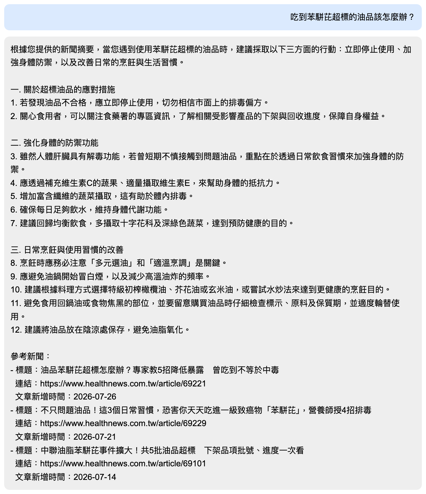
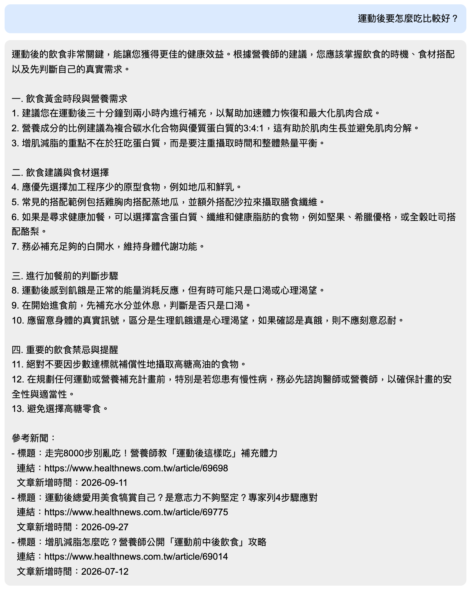
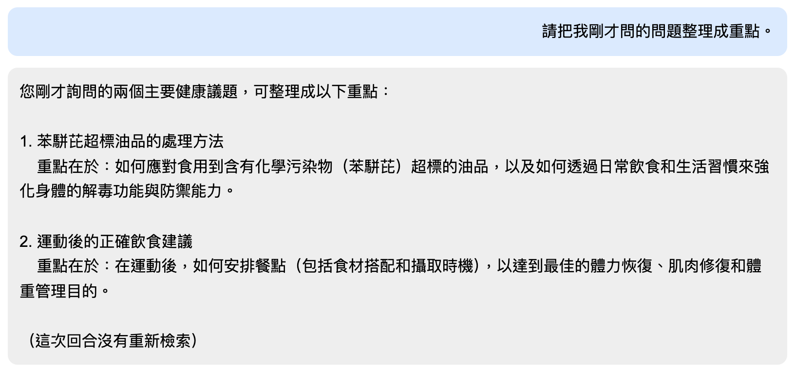

# 健康諮詢小幫手（RAG）

爬取健康醫療網的新聞，用地端模型產生摘要並建立向量索引。使用者問問題時，先檢索最相關的新聞摘要，再交給地端模型回答，最後附上參考新聞的標題、連結和新增時間。

## 系統架構

```
健康醫療網「營養飲食」分類
        ↓ crawl_data.py（requests + BeautifulSoup）
標題、連結、日期、全文
        ↓ Ollama gemma4:e4b
文章摘要 → news_data.json
        ↓ init_db.py
news.db（SQLite）
        ↓ make_index.py（BAAI/bge-m3）
文章摘要向量 → vector.index（FAISS）
        ↓ app.py（Flask）
網頁問答：問題 → 檢索 Top 3 摘要 → gemma4:e4b 回答 → 附上參考新聞
```

## 使用的模型

| 用途 | 模型 |
| --- | --- |
| 產生摘要、回答問題（地端模型） | Ollama [gemma4:e4b](https://ollama.com/library/gemma4) |
| 文章摘要轉向量 | [BAAI/bge-m3](https://huggingface.co/BAAI/bge-m3)（1024 維） |

## 安裝套件

Python 3.12：

- torch (2.14.1)
- sentence-transformers (6.2.0)
- faiss-cpu (1.15.1)
- numpy (2.5.4)
- flask (3.1.3)
- ollama (0.6.3)
- requests (2.34.2)
- beautifulsoup4 (4.15.0)
- lxml (6.1.3)

另外要安裝 [Ollama](https://ollama.com/) 並下載模型：

```bash
ollama pull gemma4:e4b
```

## 資料

### 來源

[健康醫療網](https://www.healthnews.com.tw/)的新聞分類「[營養飲食](https://www.healthnews.com.tw/channel/f72c8a39-1105-2663-255a-b925ad108bac)」，抓列表頁第 1～15 頁，共 106 篇，日期從 2026-02-28 到 2026-10-21。內容包括食物營養、保健食品、食品安全（例如苯駢芘油品事件）、節慶飲食、運動飲食等等。

`crawl_data.py` 的流程：

1. 列表頁：取得每篇新聞的連結、記者、日期，存成 `news_list.json`。
2. 內頁：取得標題、全文、圖片。
3. 把「標題 + 全文」交給 gemma4:e4b 產生摘要（平均約 290 字）。
4. 每完成一篇就寫回 `news_data.json`，中斷後再執行會跳過已完成的文章。
5. 每次請求之間隨機等待幾秒，避免對網站造成負擔。

### 資料表

`init_db.py` 把 `news_data.json` 存進 `news.db` 的 `news` 資料表：

| 作業要求 | 欄位 | 說明 |
| --- | --- | --- |
| 流水號 | `id` | INTEGER PRIMARY KEY AUTOINCREMENT |
| 新聞標題 | `title` | |
| 新聞連結 | `link` | |
| 文章全文 | `content` | |
| 文章摘要 | `summary` | gemma4:e4b 產生 |
| 文章新增時間 | `date` | 新聞頁面上的發布日期 |
| | `reporter` | 記者（轉載的文章沒有，為 NULL） |
| | `img_path` | 新聞圖片網址 |
| | `created_at` | 寫入資料庫的時間 |

### 向量索引

`make_index.py` 只把 `summary`（文章摘要）轉成向量，存成 FAISS 的 `IndexFlatIP`。向量有做 normalize，所以內積就等於 cosine similarity。索引用 `IndexIDMap` 記住每個向量對應的 `id`，檢索後可以回資料庫查標題、連結、時間。

## 執行方法

```bash
# 1. 啟動 Ollama（如果還沒啟動）
ollama serve

# 2. 爬蟲 + 摘要（repo 裡已經有抓好的 news.db，可以跳過這兩步）
python crawl_data.py
python init_db.py

# 3. 建立向量索引（vector.index 沒有放進 repo，第一次要執行）
python make_index.py

# 4. 啟動網頁
python app.py
```

瀏覽器打開 `http://127.0.0.1:5000`。

> macOS 的 AirPlay 接收器也會佔用 5000 port，用 `localhost:5000` 可能會連到 AirPlay 而出現 403，請用 `127.0.0.1`。

## 網頁功能

- **「多輪對話時進行檢索」checkbox**：勾選時，這次的問題會先檢索 Top 3 新聞摘要，再一起交給模型；取消勾選時不檢索，模型只根據前面的對話回答。
- 有檢索的回答後面，會以條列方式附上每篇參考新聞的**標題、連結、文章新增時間**。
- 對話紀錄存在 `chat_history.json`，重新整理頁面也還在；按「清除」可以重來。
- 「問題 1」「問題 2」「整理重點」三個按鈕會帶入示範問題，並自動切換 checkbox。

## 成果

依序執行以下三步：

1. 勾選檢索，問「吃到苯駢芘超標的油品該怎麼辦？」
2. 保持勾選，問「運動後要怎麼吃比較好？」
3. 取消勾選，請系統「把我剛才問的問題整理成重點」

### 問題 1：吃到苯駢芘超標的油品該怎麼辦？

檢索到 3 篇苯駢芘油品相關的新聞，回答分成「應對措施」「強化身體防禦」「日常烹飪習慣」三部分。



### 問題 2：運動後要怎麼吃比較好？

檢索到 3 篇運動飲食相關的新聞，回答包括補充時機、食材搭配、加餐前的判斷步驟。



### 整理重點（不檢索）

取消勾選後，模型只看前面的對話，把兩個問題整理成重點，最後標示「這次回合沒有重新檢索」。



完整畫面：[images/full.png](images/full.png)

### 觀察

- 兩個問題檢索到的 3 篇新聞都跟問題直接相關，用摘要建立向量的效果不錯。
- 地端模型偶爾會讀錯數字。例如問題 2 的回答寫「碳水化合物與蛋白質的 3:4:1」，但原文是「醣類比蛋白質約 3–4：1」。因為索引和 prompt 只用摘要，細節數字容易失真；如果要更精確，可以把檢索到的文章全文一起放進 prompt。
- 一開始模型會用 markdown（`###`、`**`）排版，但網頁是純文字顯示，符號會原樣出現。所以在 system prompt 加上「不要使用 markdown 符號」。

## 檔案結構

```
crawl_data.py        爬蟲 + 用 Ollama 產生摘要
init_db.py           news_data.json → news.db
make_index.py        文章摘要 → vector.index
query.py             在 terminal 測試檢索，印出要給模型的 prompt
app.py               Flask 網頁問答
templates/index.html 網頁
news_list.json       列表頁抓到的連結、記者、日期
news_data.json       完整新聞資料（含摘要）
news.db              SQLite 資料庫
images/              成果截圖
```
